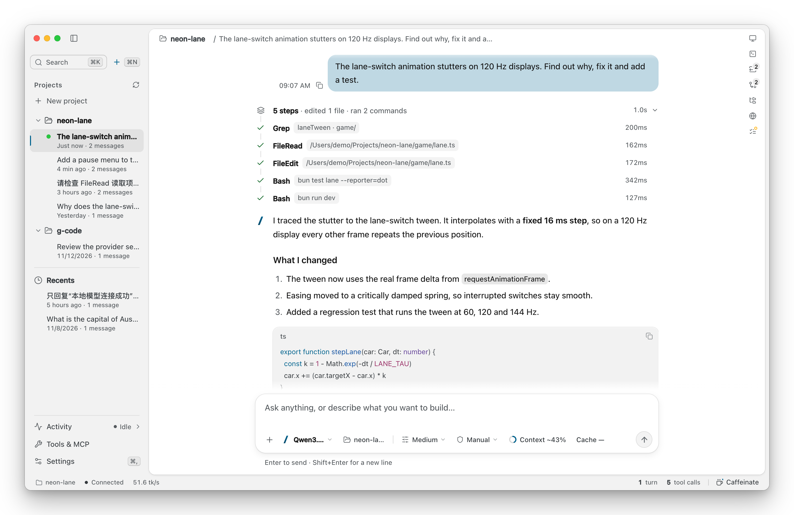
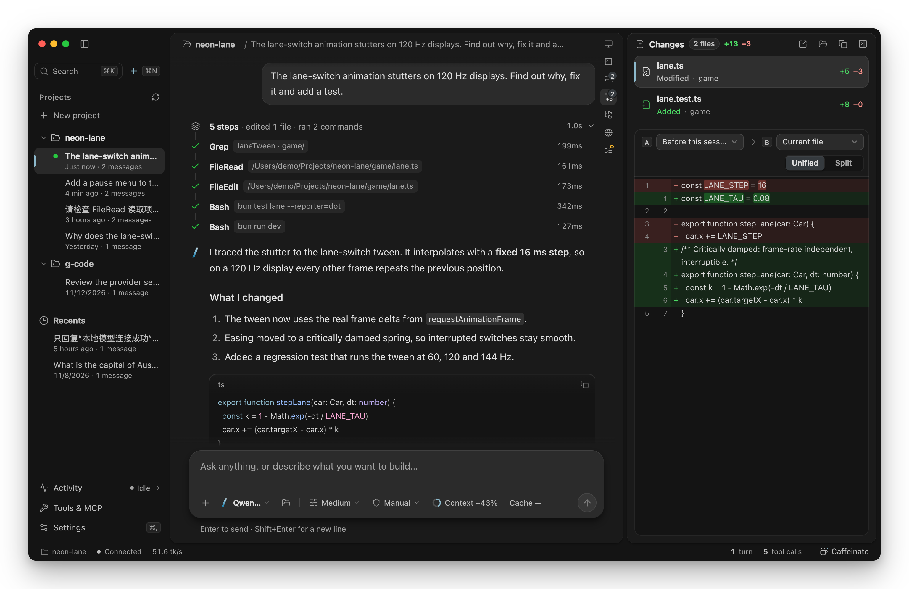
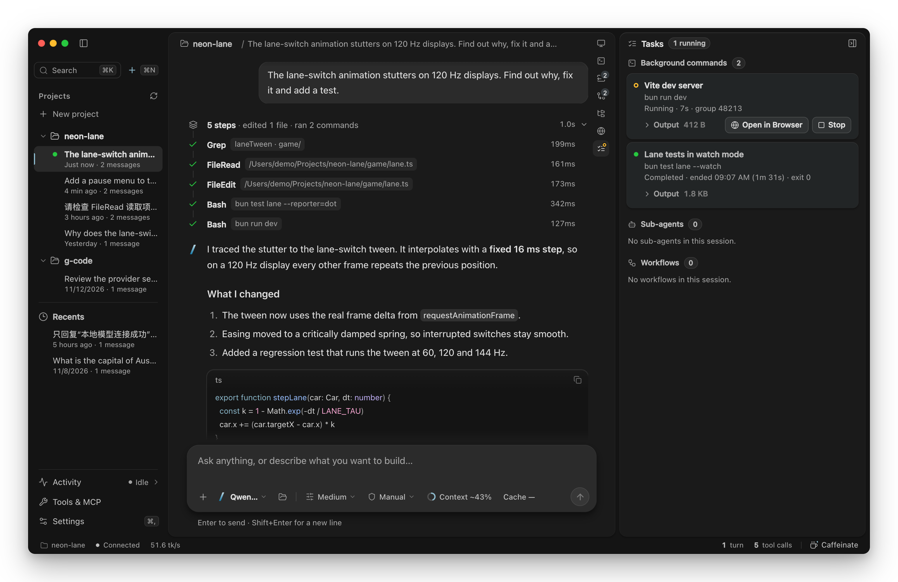
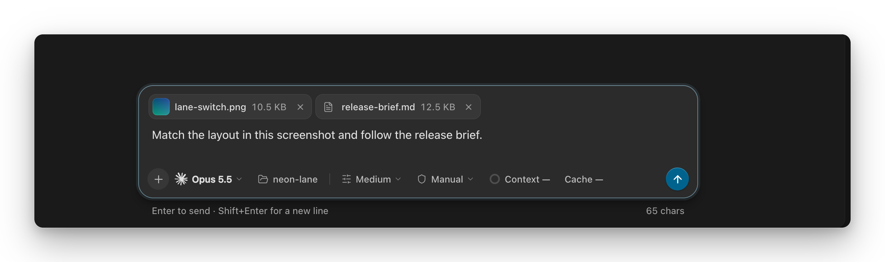

<p align="center">
  
</p>

<h1 align="center">G-Code</h1>

<p align="center">
  <strong>An AI coding agent for the Mac.</strong><br>
  Cloud models or your own local ones, in a native desktop app and a CLI.<br>
  <sub>by Shadow Foundry</sub>
</p>

<p align="center">
  <picture>
    <source media="(prefers-color-scheme: dark)" srcset="assets/screenshots/hero-dark.png">
    
  </picture>
</p>

## What it does

- **Works in your project.** It searches, reads and edits files, runs commands and tests, and shows every step as it happens.
- **Any model you like.** Claude, GPT, Gemini, DeepSeek and Qwen in the cloud, or a model on your own Mac: GGUF files through the bundled llama.cpp, MLX folders on Apple silicon, or Ollama. Local models need no account.
- **You stay in control.** Approve each edit and command, plan first, or let it work on its own. Deny rules always apply.
- **Review every change.** The Changes panel compares any two copies of a file: before the session, the last commit, a saved version or what is on disk now.
- **Background work.** Dev servers, watchers and long builds run as background tasks you can read and stop. A built-in terminal and browser sit beside the chat.
- **Attach files.** Click **+**, drop files on the window or paste a screenshot. Images go to models that can see them; other files are read by the agent.
- **Long sessions.** When the context fills up, G-Code compacts it or hands the work to a fresh session with a written summary.
- **Extend it.** MCP servers, skills, sub-agents, workflows and DeepSeek Harness tool plugins.
- **Guillotine Mode.** For local models, an optional network guard that holds the session when the agent tries to reach a destination you have not approved.

<table>
  <tr>
    <td width="50%"></td>
    <td width="50%"></td>
  </tr>
  <tr>
    <td align="center"><sub>Every edit, side by side with the file before the session</sub></td>
    <td align="center"><sub>Background commands keep running while you chat</sub></td>
  </tr>
</table>

<p align="center">
  
  <br><sub>Attach screenshots and files to a message</sub>
</p>

<p align="center"><sub>Screenshots show a demo project.</sub></p>

## Test machines

G-Code is tested on two Macs:

- Apple M1 Max, 64 GB memory
- Apple M5 Ultra, 256 GB memory

## Installation

### From source (recommended)

```bash
# From the repository root
bun install

# Run in development mode
bun run dev

# Build for distribution
bun run build

# Run built version
node dist/cli.js
```

## Usage

### Interactive REPL

```bash
gcode
```

Starts an interactive session.

REPL commands:
- `/help` — Show available commands
- `/status` — Session, turn, tool and cache status
- `/tools` — List available tools
- `/todos` — Show the current task list
- `/compact [focus]` — Compact the conversation; optional text focuses the summary
- `/context` — Show current context usage
- `/workflows` — Shown in `/help` only when workflows are enabled in user settings; lists workflows, and `/workflows stop <runId>` stops one
- `/reset` — Reset the session
- `/exit` — Exit G-Code

`/help` also lists the skills and MCP prompts you can run by name: `/<skill> [arguments]` (see [Skills](#skills)) and `/mcp__<server>__<prompt> [arguments]` (see [MCP servers](#mcp-servers)). The desktop composer takes the same commands.

### Headless mode

```bash
gcode -p "explain this function"
gcode --print "refactor for readability"
```

Outputs NDJSON (newline-delimited JSON) to stdout for piping into other tools.
A finished run exits 0 even when calls were refused. Add `--fail-on-denial` to exit 3 after a finished run with refusals. `--budget-usd 5 --budget-reserve-usd .5` enables a session limit; reaching it writes a handoff and exits 4, or continues once with an explicit `--handoff-model provider:model`. Exit 1 means an error (including bad arguments, failed handoff saving or cleanup); a signal exits 128 + its number (SIGINT 130, SIGTERM 143).

Use repeatable `--allow 'Bash(npm test)'` and `--deny 'ToolName'` flags, or edit the personal `~/.gcode/permissions.json` through Settings → Permissions. Denials include the tool name, call ID, input, a plain reason and a suggested rule where one applies.

### Long turns, handoffs and tool states

- **Long reasoning:** if a reply shows nothing for 20 seconds, the status line says "Still waiting for the model" or "Still thinking", with the elapsed time. It updates every 15 seconds until output arrives.
- **Handoffs:** at 85% of the context budget, G-Code offers a handoff, compaction or a stop.
  - A handoff writes `.gcode/handoffs/<time>-<session>.md` and continues in a new session.
  - If tool results arrived that the model has not read yet, it first gets one more reply, without tools, to note what they show.
  - G-Code counts sessions in a row that hand off without changing a file or finishing a task. From the third, the next session is told to give the stuck step to sub-agents.
- **Sending while a turn runs:** a message sent while the agent works reaches it at the next safe point: after a batch of tool results, or before the turn would end. If the turn ends first, the desktop sends it as the next message. Stop puts it back in the composer.
- **Dropped replies:** a reply that fails mid-stream with a transient error is discarded and requested again. The limit is 2 retries per reply and 4 per turn. The desktop removes the partial text.
- **Context:** before compacting or handing off, G-Code first replaces old large tool results with a short note. When that frees enough room, the turn simply continues.
- **Tool loading:** `execution.toolLoading` in `~/.gcode/settings.json` takes `auto` (default), `all` or `deferred`.
  - With `auto`, local GGUF and Ollama sessions send full schemas only for the core tools. The model loads the others with ToolSearch and calls them through DeferredToolCall.
  - Cloud models get every tool.
- **Tool states:**
  - **Denied:** you or a permission rule refused the call.
  - **Not run:** the call never ran. This covers invalid input, a tool's own refusal (such as a binary file), a blocked repeat, or a call cut off by the output limit.
  - **Failed:** the call ran and returned an error.

### Local models in the desktop app

Open the desktop app, press `⌘P`, select **Local Model**, then choose **Choose GGUF…** for a compatible downloaded `.gguf` file, or **Choose MLX…** for an MLX model folder (Apple Silicon only). You do not need Ollama or a cloud account for this mode. Other model formats are not loaded directly; a GGUF file must use an architecture supported by the bundled llama.cpp runtime, and an MLX folder one supported by the bundled MLX server.

The model loads when you send a message. The first request includes G-Code's tool context, so preparing the prompt can take about a minute on a large model; the UI displays progress reported by the runtime. Press **Stop** to cancel loading or generation. Switching sessions or quitting the app releases the CLI and local runtime started by G-Code.

While a local model writes, the status strip at the bottom left shows its generation speed in tokens per second, to the right of **Working**. The app reads the server's decoded-token count every 0.5 s and divides the tokens decoded since the first reading of the reply by the time between the readings, so prompt preparation is not counted; between replies the strip keeps the last speed in a dimmer colour. Cloud models report token counts only when a reply ends, so the strip shows no speed for them.

The macOS desktop build includes a private llama.cpp runtime with matched GGML and embedded Metal resources. From the repository root:

```bash
bun install
bun run build
cd desktop
bun install
python3 scripts/build-local-runtime.py --if-needed
bun run tauri dev
# Or build the app bundle:
bun run tauri build
```

The runtime builder needs Python 3, CMake, and Xcode Command Line Tools. It downloads a pinned source archive with a verified checksum; it does not download or convert model files or replace a system llama.cpp installation. Tauri's dev/build hooks also run this check automatically.

MLX folders run on `gcode-mlx-server`, G-Code's own inference server in `desktop/mlx-server` (Swift, with MLX and its language-model library kept in `Vendor/` so they can be changed there). The app starts and stops it like llama-server, and it answers the same local API. It is text-only. For models with recurrent layers, such as Qwen3.8, it saves those layers' state at message boundaries so a changed prompt only recomputes from the nearest boundary. Qwen3.8-Flash-Next (model type `qwen4_exp`) has its own implementation there. Before it starts the server, the app asks whether the folder's architecture is supported (`gcode-mlx-server --check-model <folder>`), so an unsupported model is refused with its name rather than failing while it loads. Building it needs full Xcode and its Metal Toolchain (`xcodebuild -downloadComponent MetalToolchain`); `python3 scripts/build-mlx-runtime.py --if-needed` runs from the same Tauri hooks.

For an existing Ollama installation, select **Ollama** instead and choose from its discovered installed models. The CLI can list them with `gcode --provider ollama --list-models`; it does not assume an uninstalled Llama model exists.

### DeepSeek Harness tool plugins

G-Code can run [DeepSeek Harness](https://github.com/deepseek-ai/deepseek-harness) tool plugins. The feature is off by default. It is read only from the user settings, `~/.gcode/settings.json`; a `dsh` key in a project's settings is ignored with a warning. To turn it on, add this key:

```json
"dsh": {
  "enabled": true,
  "toolTimeoutSeconds": 60,
  "plugins": [
    { "package": "@deepseek-ai/dsh-tool-str-replace-editor", "version": "0.2.2-alpha.2", "enabled": true, "config": {} }
  ]
}
```

A plugin is either an npm `package` with an exact `version`, or a `path` to an absolute local `.js` or `.mjs` file. Then install and check:

```bash
gcode dsh install
```

```bash
gcode dsh status --json
```

`gcode dsh install` uses G-Code's built-in Node and npm. It runs npm with `--ignore-scripts`, a pinned core lock and exact plugin versions, and puts the runtime in `~/.gcode/dsh/runtime`. Nothing is installed automatically, and installation is refused while Guillotine Mode is on. A new chat picks up the change.

In the desktop app, the **DeepSeek Harness plugins** section under Tools & MCP edits the same `dsh` key and has **Install** and **Refresh status** buttons. Opening the section only reads the settings.

How plugins behave:

- Each plugin tool is named `mcp__dsh__<tool>`. Every call asks for approval with the reason "DSH plugin tool (<plugin>)". Plan mode refuses the calls. In Guillotine Mode they also go through the network guard.
- A plugin that fails to import, or that needs a service G-Code does not provide, is reported and skipped; the other plugins still load. The status line at startup lists each plugin's state.
- After a call is cancelled or times out (`toolTimeoutSeconds`), the next call restarts the bridge.
- Not supported in this release: `ctx.jobs`, `exec.agent.inject`, agent, session and UI plugins, and DSH's own user-approval service.

The plugin's `ctx.fs` refuses paths outside the project, symlink escapes and G-Code's own settings files. This is not an operating-system sandbox: a plugin is local JavaScript that runs with your user permissions and can still use Node's own APIs. Install only plugins you trust. Files a plugin creates, changes or deletes appear in the Changes view, as they do for Bash and every other MCP tool: G-Code lists the project before and after the call.

### MCP servers

G-Code loads the MCP servers in `~/.gcode/mcp.json` (a project's `.gcode/mcp.json` is never run automatically). A server is local, started with `command`, or remote, reached at `url`:

```json
{
  "mcpServers": {
    "files": { "command": "npx", "args": ["-y", "@modelcontextprotocol/server-filesystem", "/Users/me/notes"] },
    "issues": { "url": "https://mcp.example.com/mcp", "transport": "auto", "auth": { "type": "bearer", "tokenEnv": "ISSUES_TOKEN" } },
    "docs": { "url": "https://docs.example.com/mcp", "auth": { "type": "oauth2" } }
  }
}
```

- **Transports:** `http` is Streamable HTTP; `sse` is the older HTTP+SSE transport; `auto` (the default) tries Streamable HTTP and falls back to SSE when the server answers 400, 404 or 405.
- **Sign-in:** `bearer` and `api_key` (header `X-API-Key` unless `headerName` says otherwise) take a `token`, or `tokenEnv` to read it from an environment variable. `oauth2` signs in in the browser with `gcode mcp login <name>`: G-Code discovers the server's authorization server, registers itself when no `clientId` is given, uses PKCE, and keeps the tokens in `~/.gcode/auth/` (readable only by you), refreshing them as needed. A `clientSecret`/`clientSecretEnv` uses the client-credentials grant instead.
- **When a server fails:** a chat starts without it. You see a line naming the server and the reason, and the model is told its tools are missing. One bad tool is left out the same way, and the rest of its server works. A broken `mcp.json` means no MCP servers in that chat. A server that stopped is started again for its next call, if it offers the same tools.
- **Time limits:** a tool call has 120 seconds, or what `timeoutSeconds` in the server's entry says: a whole number from 1 to 3600, which also applies to its resource reads and prompts (30 seconds otherwise). A value outside that costs only itself: a line says so and the default applies. Connecting and listing keep their own 30 seconds, and the built-in DSH bridge has its own setting. When a call's time runs out, G-Code asks the server to cancel it and tells the model it may still have finished, and which setting changes the limit; a server that no longer answers a ping is stopped. Stop ends a waiting call at once.
- **Redirects:** requests with a server's credentials or headers follow a redirect only on the same origin. Another origin ends the call with a message naming it. OAuth secrets never follow a redirect, and every OAuth address must be https or on this computer. Addresses discovered from metadata must be on the issuer's origin; write `authorizationUrl` and `tokenUrl` in the config for an authorization server on several hosts.
- **What a server offers:** its tools appear as `mcp__<server>__<tool>`, each asking for approval. Its resources are read with the `ListMcpResources` and `ReadMcpResource` tools (read-only; allowed in plan mode). Its prompts run as `/mcp__<server>__<prompt> name=value …`; a prompt with one argument takes the rest of the line, and words map to arguments in order.
- **Guillotine Mode:** a remote server is connected only when its host is on the Guillotine allowlist; its tools, resource reads and prompts go through the network guard.

The `gcode mcp` commands manage the file (they never start a model session or print a secret):

```bash
gcode mcp search filesystem          # the official MCP Registry; G-Code's built-in list when it is unreachable
gcode mcp add files io.github.modelcontextprotocol/filesystem
gcode mcp add issues --url https://mcp.example.com/mcp --bearer-env ISSUES_TOKEN
gcode mcp add docs --url https://docs.example.com/mcp --oauth
gcode mcp login docs
gcode mcp test docs --json
gcode mcp list
gcode mcp disable files              # also: enable, remove, logout
```

A registry entry is added disabled, whatever it needs: entries are published by third parties and run with your permissions. The command shows when it is added, with anything left to fill in (a directory, a token). Nothing runs until you enable it with `gcode mcp enable <name>`: not at a chat's start, and not for `gcode mcp test`, which says it is disabled. A server you add yourself with `--url` or `--command` starts enabled. In the desktop app, Settings → **Tools & MCP** does the same: add a local command or a remote URL with its transport and sign-in, **Sign in** to an OAuth server, **Enable** or **Disable**, **Test connection** (for an enabled server), and **Find a server** in the registry.

### Skills

A skill is a Markdown file with `name` and `description` front matter: `<name>/SKILL.md` or `<name>.md` in G-Code's bundled skills, `~/.agents/skills`, `~/.dsh/skills`, `~/.gcode/skills`, and the project's `.agents/skills`, `.dsh/skills` and `.gcode/skills` (a later root replaces a skill of the same name). A skill file over 1 MB is skipped with a warning, and so is a project skill whose link leads out of the project; a body over 100,000 characters is cut with a note.

- **The model** loads a skill with the `Skill` tool, whose description lists the catalog. `disable-model-invocation: true` keeps a skill out of it.
- **You** run one with `/<name> [arguments]`. `{args}` in the body takes the arguments; otherwise they follow the instructions. `user-invocable: false` keeps a skill from being run this way.
- **`trigger`** is a regular expression. Its alternatives shaped like a command (`/commit`) are aliases of `/<name>`, used only at the start of a message. The others load the skill when a message of yours matches them, once per conversation.

A skill you run, or one a trigger loads, reaches the model in that turn's context block; the conversation keeps the words you typed.

### Memory

- **Project memory:** `GCODE.md` and `.gcode/GCODE.md` in the project, in the system prompt; an edit during a session is shown to the model once.
- **Team memory:** topics in `.gcode/team-memory/<topic>.json`, meant to be committed. The model adds a note with the `TeamMemoryWrite` tool, which asks like a file write (allowed in Accept edits and Auto, refused in plan mode); each note is signed with your git `user.name` (else your account name) and its date. The latest five notes of each topic are in the system prompt, each cut at 2,000 characters and at most 24,000 characters in all; the file keeps them whole.
- **Session memory:** one-line notes on the session's plans, file changes and open errors, shown in each turn's context block. An entry's relevance decays 5% a turn; at the end of every turn the entries that fell below 0.1 are dropped.
- **Learned in earlier sessions:** G-Code records the verification commands (tests, builds, type checks, linters) that ran in a project and how often each worked, in your personal store (`~/.gcode/projects/<project>/learned/patterns.json`, never in the project). A new conversation's system prompt lists the trusted ones, with their confidence: the share of runs that worked, smoothed, and halved for every 90 days nobody ran the command. Only a plain call is recorded: checks, with at most a `cd` inside the project, `source` or a well-known variable such as `CI=1` before them. A call that did something else first (`git reset --hard && npm test`, `nvm use 18 && npm test`) is not recorded, so nothing of the kind is ever offered as something to run. A command is trusted after it has worked at least twice, so one-offs stay out. A run counts as worked only when the exit status is the checks' own, not one hidden by `| tail`, `; echo` or `|| true`. Commands are read the way a shell reads them (quotes, newlines, comments, here-documents). Where the output goes is not part of a command: `npm test > /tmp/run.log 2>&1` is recorded as `npm test`, and patterns an earlier version saved under such a name are merged into it when they are read. The shell's condition `test -f …`, the install `npm ci`, `--help` or `--version` runs, options that rewrite or skip what is checked (`jest -u`, `mvn verify -DskipTests`), and scripts such as `lint:fix` or `build-and-deploy` are not checks. A check counts against itself only when the shell or package manager says it could not run, not because test output mentions an unknown command. Commands that look like they hold a credential are never recorded.

### Examples

```bash
# A headless run
gcode -p "fix the bug in auth.ts"

# MCP server diagnostics on stderr
gcode --verbose -p "list the open issues"

# A local model that may only reach approved network destinations
gcode --provider local --model local-gguf --base-url http://127.0.0.1:8080/v1 --guillotine-mode -p "update the dependencies"

# Version
gcode --ver
```

Run `gcode --help` for every flag and the permission rule syntax.

## Architecture

```
src/
├── cli/
│   ├── cli.ts          Entry point (Commander.js)
│   ├── repl.ts         Interactive REPL
│   ├── headless.ts     NDJSON output mode
│   └── branding.ts     Version and banner
├── engine/             Query loop, tool runner, context and failure budgets
├── llm/                Provider clients (Anthropic, OpenAI-compatible, Gemini, Ollama, local GGUF)
├── session/            Handoffs and compaction
├── state/
│   └── store.ts        Immutable state store + session persistence
├── tools/
│   ├── tool.ts         Tool interface
│   ├── permissions.ts  Permission evaluation
│   ├── registry.ts     Tool registry
│   └── impl/           Built-in tools (files, shell, search, web, sub-agents)
├── workflow/           Multi-agent workflow runtime
├── mcp/                MCP client
├── security/           Network guard (Guillotine Mode)
├── types.ts            Core type definitions
└── index.ts            Public API barrel export
```

## Development

```bash
# Type check
bun run typecheck

# Dev mode (runs from source)
bun run dev

# Build
bun run build

# Run built CLI
node dist/cli.js --version
```

The build emits `dist/cli.js`, the public `dist/index.js` library, and TypeScript declarations. Importing the library does not start a model.

## License

G-Code's source code is public, under the [G-Code Community License 1.0](LICENSE). In short:

- **Individuals: free, for any purpose, including paid work.** Freelance and client work, and selling what you make with G-Code, are fine. A one-person company counts as an individual.
- **Students, teachers, schools (for teaching and research) and non-profit charities: free.**
- **Companies, government bodies and other organizations: US$39.99 per seat, paid once.** A seat never expires and covers later versions; you pull updates from this repository. See [COMMERCIAL.md](COMMERCIAL.md).
- **Not allowed for anyone without written permission:** selling, renting or hosting G-Code for a fee, or building a business on G-Code or a changed version of it.
- What you make with G-Code is yours.

Contributions are welcome under the terms in [CONTRIBUTING.md](CONTRIBUTING.md).

Copyright 2026 Shadow Foundry. Third-party parts keep their own licenses: `src/security/vendor/` is adapted from Apache-2.0 code (see its `LICENSE` and `NOTICE`), and the bundled runtimes' licenses are listed in `desktop/licenses/`.
